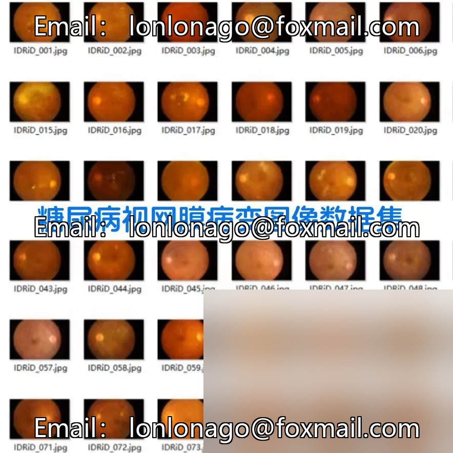
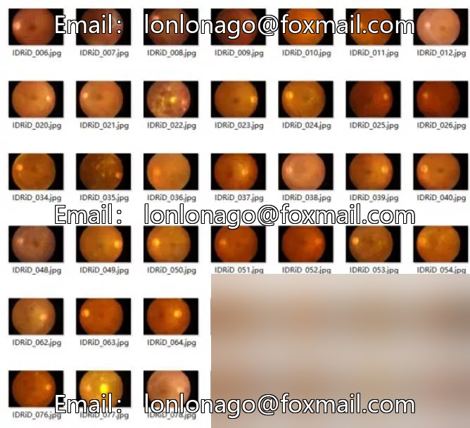
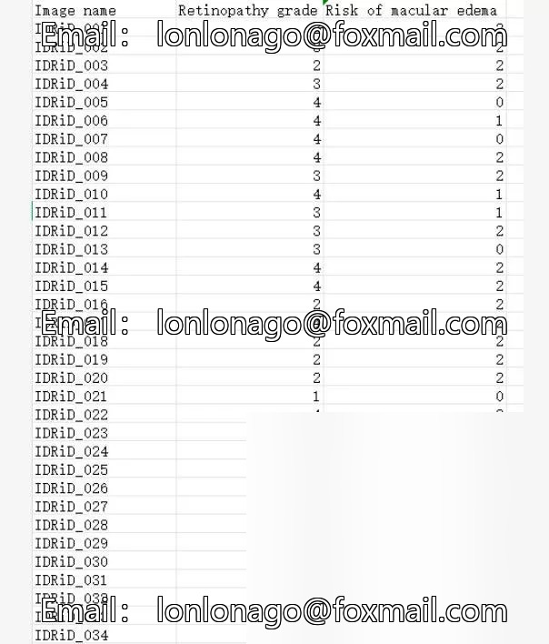

# Diabetic retinopathy image dataset

## Body

Diabetic retinopathy image dataset

[Dataset Structure]
Segmentation (81 images)
Color fundus images (JPG)
Pixel-level ground truth pathological mask: arteriolar aneurysms, hemorrhage, hard exudates, soft exudates (TIFF)
Ground truth disc mask (TIFF)
Triage (516 images)
Color fundus images (413 training set, 103 test set - JPG)

[Ground truth severity label]
Retinal degeneration of diabetes
Diabetic macular edema (CSV)
Localization (516 images)
Colored fundus image (JPG)

[Real CSV labels]
Central position of optic papilla center
Central position of macula

Diabetic retinopathy (DR) is one of the main causes of preventable blindness, especially for the global working-age population. Early detection is crucial, but low-cost large-scale screening remains a major challenge in clinical practice.

Computer-aided diagnostics (CAD) in retinal image analysis has become a powerful solution to assist ophthalmologists, which can screen eye-related diseases associated with diabetes more quickly, more affordably, and more reliably.

The IDRiD image dataset for diabetic retinopathy in India is the first benchmark dataset representing the Indian population. It uniquely provides typical diabetic retinopathy and normal retinal structures, and is carefully annotated at the pixel level by clinical experts.

The dataset is widely used for:
Assessing the severity of DR and diabetic macular edema (DME)
Developing algorithms for segmentation, classification, and localization tasks
Benchmarking and validating AI/ML models for early detection and diagnosis of diabetic retinopathy

web-based shipment, can be directly photographed and shipped.

The dataset includes diabetic retinal lesion images, pixel-level masks, disease grades and labels, along with IDRiD sample identifiers and classification data.

<!-- AI_ENRICHED -->

## Images

## Payment

Here is a pay link on Stripe ( https://buy.stripe.com/3cs8yP7sY87d0vu9AB ). Please contact me lonlonago@foxmail.com after funding $89, and I will send you a complete data files , thank you!

